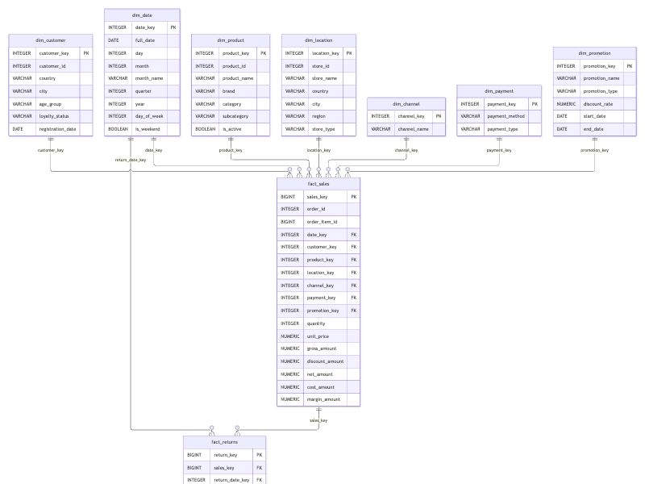

# Szkic projektu hurtowni danych — Notino

## Temat
Projekt i implementacja hurtowni danych oraz analiza
sprzedaży i zachowań klientów sieci Notino.

## Zespół
1. Liliia Hurko
2. Joanna Jurkowska
3. Daniel Saletnik

## Cel projektu
Celem projektu jest stworzenie hurtowni danych
umożliwiającej analizę sprzedaży, rentowności
oraz zachowań zakupowych klientów sieci Notino.

Projekt będzie oparty na syntetycznych danych
symulujących działalność przedsiębiorstwa.

## Procesy biznesowe
1. Sprzedaż produktów kosmetycznych.
2. Zwroty produktów.

## Model danych
Model wymiarowy oparty na schemacie gwiazdy.

Tabele faktów:
- fact_sales
- fact_returns

Tabele wymiarów:
- dim_customer
- dim_product
- dim_date
- dim_location
- dim_channel
- dim_payment
- dim_promotion

## Ziarno tabel faktów

fact_sales:
Jedna pozycja zamówienia.

fact_returns:
Jedno zdarzenie zwrotu dotyczące
konkretnej pozycji zamówienia.

## Zakres danych
- Okres: 2024–2026
- Klienci: 2000–3000
- Produkty: 400–600
- Zamówienia: 15000–20000
- Rynki: Polska, Czechy, Słowacja, Węgry

## Technologie
- PostgreSQL
- pgAdmin 4
- Python
- Power BI Desktop

## Proces ETL
Dane syntetyczne zostaną wygenerowane w Pythonie.

Proces ETL obejmie:
- pobieranie danych,
- czyszczenie i walidację,
- ładowanie do hurtowni PostgreSQL.

## Planowane analizy
1. Analiza sprzedaży w SQL.
2. Analiza OLAP.
3. Interaktywny dashboard Power BI.
4. Segmentacja klientów — RFM i K-Means.
5. Analiza koszykowa — Apriori.

## Załącznik

